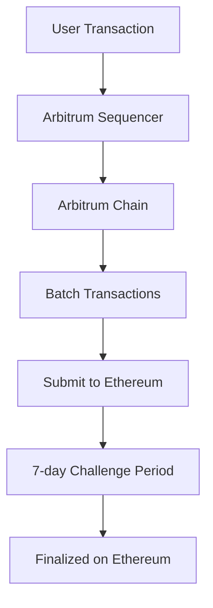

import { CodeWindow } from "../components/CodeWindow";

# Blockchain Layer 2 Scaling: Polygon, Arbitrum, and Optimism Guide

The blockchain trilemma has long been a fundamental challenge in the cryptocurrency space: how do you achieve decentralization, security, and scalability simultaneously? Ethereum, while pioneering smart contract functionality, has faced significant scalability issues with high gas fees and slow transaction times during peak usage.

Enter Layer 2 scaling solutions—a revolutionary approach that maintains Ethereum's security while dramatically improving transaction throughput and reducing costs.

## Understanding Layer 2 Solutions

Layer 2 solutions are secondary protocols built on top of Ethereum (Layer 1) that process transactions off the main chain while still benefiting from Ethereum's security guarantees. Think of them as express lanes on a highway—they handle the traffic more efficiently while still being part of the same road system.

### Key Benefits of Layer 2

- **Reduced Gas Fees**: Transactions can cost 90%+ less than Ethereum mainnet
- **Faster Transactions**: Near-instant finality for most operations
- **Ethereum Security**: Inherit Ethereum's robust security model
- **EVM Compatibility**: Existing Ethereum dApps can deploy with minimal changes

## Polygon: The Swiss Army Knife of Scaling

Polygon (formerly Matic) has evolved into a comprehensive multi-chain scaling platform. It's not just one solution but a toolkit for building and connecting Ethereum-compatible blockchain networks.

### Polygon PoS Chain

The most popular Polygon solution is its Proof-of-Stake sidechain, which offers:

<CodeWindow title="polygon-setup.js">
```javascript
// Deploying to Polygon is as simple as changing your RPC endpoint
const provider = new ethers.JsonRpcProvider("https://polygon-rpc.com");

// Gas fees are dramatically lower
const gasPrice = await provider.getGasPrice();
console.log(`Polygon gas price: ${ethers.formatUnits(gasPrice, "gwei")} gwei`);
// Typical result: 30-100 gwei vs 20,000+ gwei on Ethereum

````
</CodeWindow>

### Polygon zkEVM

Polygon's zero-knowledge Ethereum Virtual Machine brings the benefits of zk-proofs:

<CodeWindow title="Counter.sol">
```solidity
// Smart contracts work identically on Polygon zkEVM
contract Counter {
    uint256 public count;

    function increment() public {
        count += 1;
        // This transaction will be proven with zero-knowledge proofs
        // and settled on Ethereum for ultimate security
    }
}
````

</CodeWindow>

### Development on Polygon

Setting up a Polygon development environment:

<CodeWindow title="hardhat.config.js">
```javascript
// hardhat.config.js
module.exports = {
  networks: {
    polygon: {
      url: "https://polygon-rpc.com",
      accounts: [process.env.PRIVATE_KEY],
      gasPrice: 35000000000, // 35 gwei
    },
    polygonMumbai: {
      url: "https://rpc-mumbai.matic.today",
      accounts: [process.env.PRIVATE_KEY],
    },
  },
};
```
</CodeWindow>

## Arbitrum: Optimistic Rollup Excellence

Arbitrum uses optimistic rollups, assuming transactions are valid by default and only running fraud proofs when disputes arise. This approach offers excellent compatibility with existing Ethereum infrastructure.

### Arbitrum One Architecture



### Deploying on Arbitrum

<CodeWindow title="arbitrum-deploy.js">
```javascript
// The beauty of Arbitrum: your existing Ethereum code works unchanged
const contract = await ethers.deployContract("MyContract", [], {
  // Arbitrum One network configuration
  gasLimit: 1000000,
  // Gas prices are typically 0.1-0.5 gwei
});

console.log(`Deployed to Arbitrum at: ${contract.target}`);

````
</CodeWindow>

### Arbitrum vs Ethereum Cost Comparison

<CodeWindow title="cost-comparison.js">
```javascript
// Cost comparison function
async function compareCosts() {
  const ethereumGas = 20000000000; // 20 gwei
  const arbitrumGas = 100000000; // 0.1 gwei
  const gasUsed = 21000; // Simple transfer

  const ethereumCost = (ethereumGas * gasUsed) / 1e18;
  const arbitrumCost = (arbitrumGas * gasUsed) / 1e18;

  console.log(`Ethereum cost: ${ethereumCost} ETH`);
  console.log(`Arbitrum cost: ${arbitrumCost} ETH`);
  console.log(
    `Savings: ${(((ethereumCost - arbitrumCost) / ethereumCost) * 100).toFixed(
      2
    )}%`
  );
}
````

</CodeWindow>

## Optimism: The EVM Equivalent Pioneer

Optimism pioneered the optimistic rollup approach and maintains the closest compatibility with Ethereum's EVM. It's the foundation for several major projects and has recently introduced innovative governance mechanisms.

### Optimism's Unique Features

<CodeWindow title="optimism-gas-oracle.js">
```javascript
// Optimism includes built-in fee estimation
const OptimismGasOracle = "0x420000000000000000000000000000000000000F";

// Get L1 data fee (unique to Optimism)
const l1DataFee = await provider.call({
to: OptimismGasOracle,
data: "0xf8206140" + transaction.data.slice(2).padStart(64, "0"),
});

console.log(`L1 Data Fee: ${ethers.formatEther(l1DataFee)} ETH`);

````
</CodeWindow>

### Cross-Chain Communication

<CodeWindow title="CrossChainGreeter.sol">
```solidity
// Optimism's cross-domain messenger
import { ICrossDomainMessenger } from "@eth-optimism/contracts/libraries/bridge/ICrossDomainMessenger.sol";

contract CrossChainGreeter {
    ICrossDomainMessenger messenger;

    function sendGreeting(string memory _greeting) public {
        messenger.sendMessage(
            targetContract,
            abi.encodeWithSignature("receiveGreeting(string)", _greeting),
            1000000 // gas limit for L1 execution
        );
    }
}
```
</CodeWindow>

## Performance Comparison

| Metric          | Ethereum  | Polygon PoS    | Arbitrum   | Optimism   |
| --------------- | --------- | -------------- | ---------- | ---------- |
| TPS             | 15        | 7,000+         | 4,500+     | 4,000+     |
| Finality        | 12-19 min | 2-3 sec        | 1 sec      | 1 sec      |
| Gas Cost        | $5-50+    | $0.01-0.10     | $0.10-1.00 | $0.10-1.00 |
| Withdrawal Time | Instant   | 45 min-3 hours | 7 days     | 7 days     |

## Development Best Practices

### 1. Gas Optimization Strategies

<CodeWindow title="L2Optimized.sol">
```solidity
// Optimize for L2 characteristics
contract L2Optimized {
    // Pack structs to minimize calldata
    struct User {
        address wallet;     // 20 bytes
        uint64 timestamp;   // 8 bytes
        uint32 level;       // 4 bytes
    } // Total: 32 bytes (1 slot)

    // Use events for data that doesn't need on-chain storage
    event DataLogged(uint256 indexed id, bytes32 hash);

    function logData(uint256 id, bytes calldata data) external {
        emit DataLogged(id, keccak256(data));
        // Cheaper than storing the full data on-chain
    }
}
```
</CodeWindow>

### 2. Cross-Chain State Management

<CodeWindow title="MultiChainState.js">
```javascript
// Multi-chain state synchronization
class MultiChainState {
  constructor() {
    this.providers = {
      ethereum: new ethers.JsonRpcProvider(ETH_RPC),
      polygon: new ethers.JsonRpcProvider(POLYGON_RPC),
      arbitrum: new ethers.JsonRpcProvider(ARBITRUM_RPC),
      optimism: new ethers.JsonRpcProvider(OPTIMISM_RPC),
    };
  }

  async syncState(contractAddresses) {
    const promises = Object.entries(this.providers).map(
      async ([chain, provider]) => {
        const contract = new ethers.Contract(
          contractAddresses[chain],
          ABI,
          provider
        );
        const state = await contract.getState();
        return { chain, state };
      }
    );

    return Promise.all(promises);
  }
}
```
</CodeWindow>

### 3. Error Handling and Fallbacks

<CodeWindow title="fallback-handler.js">
```javascript
// Robust multi-chain transaction handling
async function executeWithFallback(primaryChain, fallbackChain, transaction) {
  try {
    return await transaction.execute(primaryChain);
  } catch (error) {
    if (error.code === "INSUFFICIENT_FUNDS") {
      console.log(`Falling back to ${fallbackChain.name}`);
      return await transaction.execute(fallbackChain);
    }
    throw error;
  }
}
```
</CodeWindow>

## Future Outlook: The Multi-Chain Reality

The blockchain ecosystem is evolving toward a multi-chain future where different L2s serve specific use cases:

- **Polygon**: Enterprise solutions and high-throughput applications
- **Arbitrum**: DeFi protocols requiring maximum EVM compatibility
- **Optimism**: Governance-heavy applications and public goods funding

### Interoperability Solutions

<CodeWindow title="bridge-integration.js">
```javascript
// Cross-chain bridge integration example
const bridge = new LayerZeroBridge();

await bridge.transfer({
  fromChain: "polygon",
  toChain: "arbitrum",
  token: "USDC",
  amount: ethers.parseUnits("100", 6),
  recipient: userAddress,
});
```
</CodeWindow>

## Conclusion

Layer 2 scaling solutions have matured significantly, offering developers and users viable alternatives to Ethereum's mainnet limitations. The choice between Polygon, Arbitrum, and Optimism depends on your specific requirements:

- **Choose Polygon** for maximum flexibility and lowest costs
- **Choose Arbitrum** for seamless Ethereum compatibility and robust DeFi ecosystem
- **Choose Optimism** for governance-focused applications and public goods alignment

The future belongs to a multi-chain ecosystem where applications seamlessly operate across multiple L2s, providing users with the best experience regardless of the underlying infrastructure.

As we move forward, the focus shifts from "which L2 will win" to "how can we build applications that leverage the strengths of multiple chains." The tools and patterns we've explored in this guide provide the foundation for building truly scalable, cost-effective blockchain applications.

_Ready to start building on Layer 2? The infrastructure is mature, the tools are available, and the ecosystem is thriving. The only question is: which scaling solution will power your next breakthrough application?_
````
